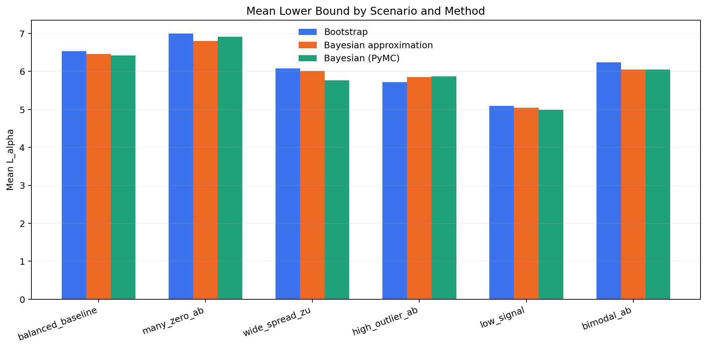
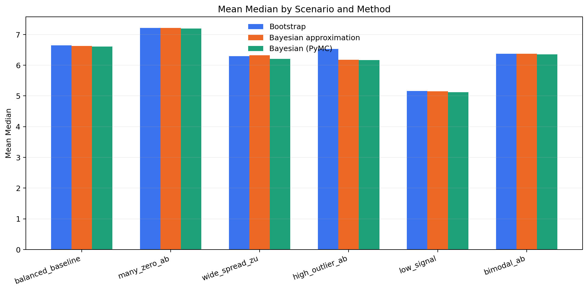
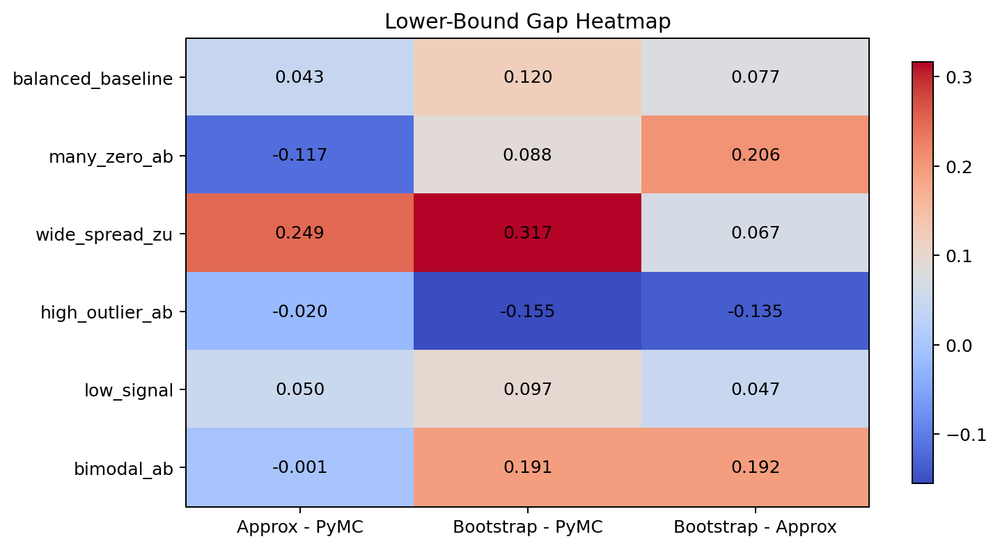
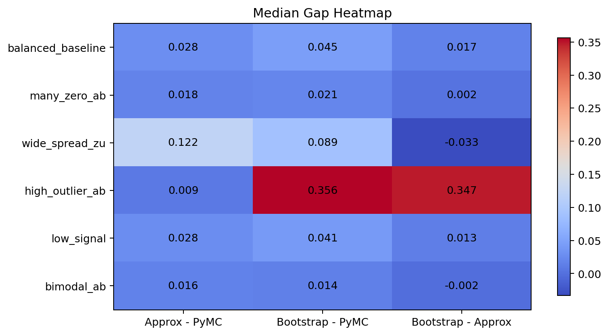

# Edge-Case Method Comparison Report

This report summarizes the synthetic edge-case study comparing:

- `Bootstrap`
- `Bayesian approximation`
- `Bayesian (PyMC)`

Each scenario contains 5 synthetic datasets of sample size 12. Reported method statistics are scenario-level means across those 5 replicates.

Effluent zero handling: `floor_at_one` (see `lrv.py`). Eq. (5-2) of the FlexTreat Validierungsleitfaden corresponds to `floor_at_one`, which applies the floor of 1 to zero counts only.

## Scenario Guide

- `balanced_baseline`: Moderately spread positive vals_zu with ordinary count-like vals_ab and no special pathologies.
- `many_zero_ab`: vals_ab contains many zeros, stressing zero inflation and the Eq. (5-2) floor applied to zero effluent counts.
- `wide_spread_zu`: vals_zu has very large multiplicative spread, creating heavy skew and occasional extreme inflow values.
- `high_outlier_ab`: vals_ab is mostly ordinary counts but includes one very large outlier, testing robustness to extreme output observations.
- `low_signal`: vals_zu is lower and tighter while vals_ab is relatively larger, producing weaker reduction and less separation.
- `bimodal_ab`: vals_ab mixes a near-zero cluster with a much higher cluster, creating a two-mode denominator distribution.

## Method Statistics

| Scenario | Method | Mean L_alpha | Mean Median | Mean Mean | Mean SD |
| --- | --- | --- | --- | --- | --- |
| balanced_baseline | Bootstrap | 6.537 | 6.647 | 6.652 | 0.077 |
| balanced_baseline | Bayesian approximation | 6.461 | 6.630 | 6.624 | 0.093 |
| balanced_baseline | Bayesian (PyMC) | 6.418 | 6.602 | 6.594 | 0.099 |
| many_zero_ab | Bootstrap | 7.004 | 7.217 | 7.216 | 0.118 |
| many_zero_ab | Bayesian approximation | 6.798 | 7.214 | 7.177 | 0.197 |
| many_zero_ab | Bayesian (PyMC) | 6.915 | 7.196 | 7.178 | 0.149 |
| wide_spread_zu | Bootstrap | 6.083 | 6.292 | 6.309 | 0.171 |
| wide_spread_zu | Bayesian approximation | 6.016 | 6.325 | 6.314 | 0.171 |
| wide_spread_zu | Bayesian (PyMC) | 5.766 | 6.203 | 6.177 | 0.233 |
| high_outlier_ab | Bootstrap | 5.719 | 6.526 | 6.389 | 0.365 |
| high_outlier_ab | Bayesian approximation | 5.853 | 6.179 | 6.165 | 0.170 |
| high_outlier_ab | Bayesian (PyMC) | 5.874 | 6.170 | 6.158 | 0.165 |
| low_signal | Bootstrap | 5.088 | 5.164 | 5.164 | 0.053 |
| low_signal | Bayesian approximation | 5.041 | 5.151 | 5.146 | 0.060 |
| low_signal | Bayesian (PyMC) | 4.991 | 5.123 | 5.117 | 0.071 |
| bimodal_ab | Bootstrap | 6.245 | 6.370 | 6.396 | 0.121 |
| bimodal_ab | Bayesian approximation | 6.053 | 6.372 | 6.356 | 0.168 |
| bimodal_ab | Bayesian (PyMC) | 6.054 | 6.356 | 6.345 | 0.166 |

## Lower-Bound Gap Table

| Scenario | Approx - PyMC | Bootstrap - PyMC | Bootstrap - Approx |
| --- | --- | --- | --- |
| balanced_baseline | 0.043 | 0.120 | 0.077 |
| many_zero_ab | -0.117 | 0.088 | 0.206 |
| wide_spread_zu | 0.249 | 0.317 | 0.067 |
| high_outlier_ab | -0.020 | -0.155 | -0.135 |
| low_signal | 0.050 | 0.097 | 0.047 |
| bimodal_ab | -0.001 | 0.191 | 0.192 |

## Median Gap Table

| Scenario | Approx - PyMC | Bootstrap - PyMC | Bootstrap - Approx |
| --- | --- | --- | --- |
| balanced_baseline | 0.028 | 0.045 | 0.017 |
| many_zero_ab | 0.018 | 0.021 | 0.002 |
| wide_spread_zu | 0.122 | 0.089 | -0.033 |
| high_outlier_ab | 0.009 | 0.356 | 0.347 |
| low_signal | 0.028 | 0.041 | 0.013 |
| bimodal_ab | 0.016 | 0.014 | -0.002 |

## Visualizations

### Mean Lower Bound by Scenario

### Mean Median by Scenario

### Lower-Bound Gap Heatmap

### Median Gap Heatmap

